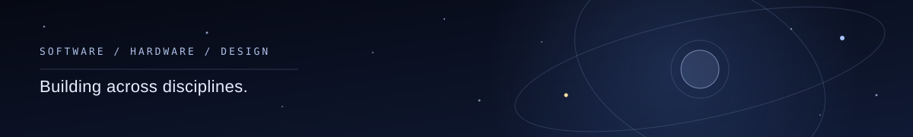

<h1 align="center">Bede Lau</h1>

EE student @ KCL · SWE · 11x hackathon winner

<a href="https://bede-lau.github.io/">Portfolio</a> · <a href="https://www.linkedin.com/in/bede-lau/">LinkedIn</a> · <a href="mailto:bedelau59@gmail.com">Email</a>

Started with computer vision, quantitative finance, multi-agent systems, and ERP data pipelines. Getting into avionics, submersibles, robotics, and photonics.

## ▍Selected builds

<table>
<tr>
<td width="50%"> <b>Morpheus</b> · Room scans and robot task rollouts</td>
<td width="50%"> <b>Cottrell</b> · Battery microscopy and traceable insights</td>
</tr>
</table>

| Project | What it explores | Recognition |
| --- | --- | --- |
| [Morpheus](https://github.com/bede-lau/Morpheus) | Room scans, SimReady objects and planned robot task rollouts | 🥇 OpenAI DevDay Exchange Community Hackathon, London |
| [PasarAI](https://github.com/bede-lau/PasarAI) | Voice-first financial workflows for food vendors | 🥇 KL Codex Community Hackathon |
| [Project106](https://github.com/bede-lau/affordablehousing) | London housing and planning-data exploration | 🥈 London House Data Hackathon |
| [CanvasCraft](https://github.com/bede-lau/CanvasCraft) | Three interactive prototype directions from one wireframe | 🥈 Daytona Hacksprint Singapore |
| [CareAxiom](https://github.com/bede-lau/CareAxiom) | Evidence-led healthcare planning | 🥉 Hack-Nation Global AI Hackathon, Databricks challenge |
| [RockedIn](https://github.com/bede-lau/rockedin) | A professional network for rocks | 🥉 Qwen Brainrot Hackathon |
| [Matter Lab](https://github.com/bede-lau/matter) | Interactive metamaterials and 3D learning | 🏆 Best Astra Build, Astra Commons KL |
| [SitePilot](https://github.com/bede-lau/SitePilot) | Solar field operations and procurement | 🥇 KrackedDevs Vibe-a-thon 2026 |
| [Chrono](https://github.com/bede-lau/chrono) | Interactive quantum organisms | 🏆 Hackathon win |
| [Fishy](https://github.com/jabuar-exe/fishy) | Editable 3D aquascapes | — |
| [Cottrell](https://github.com/Cottrell-LockedIn/AIxScience) | Battery microscopy, classification and review | — |

## ▍Skills & tools

**Languages** · Python, TypeScript, JavaScript, SQL, C++

**AI & data** · Computer vision, machine learning (PIML), multi-agent systems, RAG, GraphRAG, OpenCV, PyTorch, Vertex AI, SAM-3, 4D-Humans, FASHN VTON, pgvector, graph databases

**Software & web** · React, Next.js, React Native, Expo, Node.js, FastAPI, Tailwind CSS, D3.js, PostgreSQL, Supabase, Celery, Redis

**ERP & workflows** · Frappe, ERPNext, n8n, enterprise data pipelines

**Simulation & hardware** · Three.js, MuJoCo, Gaussian splats, NVIDIA SimReady, ESP32, Raspberry Pi Pico, IoT and embedded systems

**Infrastructure & deployment** · AWS, Vercel, ngrok, OpenRouter, OpenClaw, Vast.ai, Hugging Face

**Other work** · Quantitative finance and algorithmic trading

## ▍Exploring

Avionics, submersibles, robotics, and photonics — especially where software meets real-world hardware constraints.

<a href="https://bede-lau.github.io/">Explore the full portfolio ↗</a>

